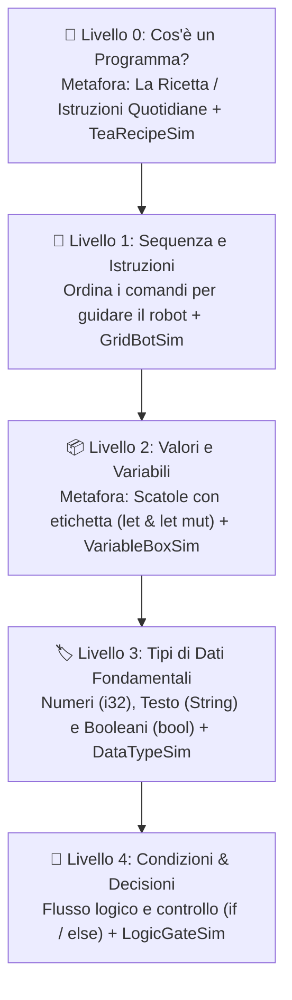

# 🚀 Context Document: Coding Learn Platform ("Coding Game Contest")

## 📌 1. Sintesi del Progetto e Analisi Integrata dei Requisiti

Il presente documento definisce la visione, i vincoli, la metodologia didattica, l'architettura e la roadmap per la **Coding Learn Platform**, integrando le specifiche del contest (`Coding_game_contest.pdf`) con le direttive pedagogiche dettagliate per principianti assoluti (`informazioni aggiuntive.md`).

### 🎯 Target Audience & Obiettivo Primario
- **Target Audience**: **Principianti assoluti** (persone che *non hanno mai programmato* in vita loro).
- **Obiettivo**: Creare un prototipo **funzionante, ultra-intuitivo, didatticamente progressivo ed esteticamente d'impatto (WOW factor)** per introdurre gradualmente i concetti fondamentali del coding.
- **Linguaggio Target**: **Rust** (sintassi pulita e concetti espressivi), presentato con spiegazioni chiare e metafore visive, **completamente diverso da Java, Python e JavaScript**.

### ⚠️ Vincoli Obbligatori e Regole Strategiche
1. **Linguaggi Vietati**: ❌ Java, Python, JavaScript.
2. **Pedagogia Obbligatoria**: **Spiegare PRIMA di mettere alla prova**. Mai lanciare l'utente in un esercizio senza aver prima fornito spiegazione, esempio e simulatore visivo.
3. **Flusso Didattico Ottimizzato (Zero Passi Passivi)**:
   $$\text{Spiegazione Teorica} \longrightarrow \text{Esempio Pratico} \longrightarrow \text{Esercizio Semplice} \longrightarrow \text{Esercizio Autonomo} \longrightarrow \text{Consolidamento (Badge)}$$
   *Nota*: I simulatori visivi interattivi sono integrati direttamente ed in modo permanente sul pannello di destra durante tutti i passi di ciascun livello, eliminando schermate dimostrative passive.
4. **Nessuna Registrazione / Autenticazione**: Accesso immediato "click & play" senza form di iscrizione (vietati dal bando).
5. **Nessun Backend / Database Complesso**: Persistenza locale dello stato (XP, badge, livello) via `localStorage`.
6. **Parametri di Valutazione dei Giudici**:
   a. **Coinvolgimento** (Gamification, ritmo, feedback visivo/sonoro immediato).
   b. **Intuitività** (Zero barriere sintattiche, metafore concrete come le scatole per le variabili).
   c. **Estetica & UI/UX** (Design Cyber Arcade / Synthwave Dark Mode, animazioni fluide).
   d. **Capacità reali di apprendimento** (Progressione dai concetti base di algoritmo alle condizioni).

---

## 📚 2. Progressione Didattica e Struttura dei Livelli

Per garantire un apprendimento dinamico e privo di tempi morti, ogni livello affianca la teoria, gli esempi e gli esercizi al relativo **Simulatore Visivo Interattivo sempre attivo**:

---

## 🎨 3. Design System & UI/UX Experience

* **Stile Visivo**: **Cyber Arcade / Synthwave Dark Mode** con font moderni e contrasti neon.
* **Mappa & Breadcrumb Permanenti**:
  - Header superiore con indicazione XP, Streak di risposte corrette, Livello Attuale e Breadcrumb cliccabile.
* **Layout Didattico a Doppia Colonna**:
  - **Sinistra**: Teoria, Metafora reale, Sintassi di esempio e pulsante di proseguimento rapido.
  - **Destra**: Simulatore visivo interattivo sempre attivo + Quesiti / Sfide di riordinamento.
* **Gamification & Suoni**:
  - Effetti sonori rétro (Web Audio API) per selezioni, errori e completamenti.
  - Coriandoli animati e badge sbloccabili con modale celebrazione al completamento di ogni livello.

---

## 🏗️ 4. Architettura Tecnica

* **Tech Stack**: HTML5, Vanilla CSS / Tailwind CSS con custom design system, JavaScript / React (SPA).
* **Gestione Stato Client-Only**: Stato del progresso salvato in tempoリアル su `localStorage`.
* **Valutazione Istantanea**: Risposta ed esecuzione logica immediate per garantire zero attese al giocatore.
